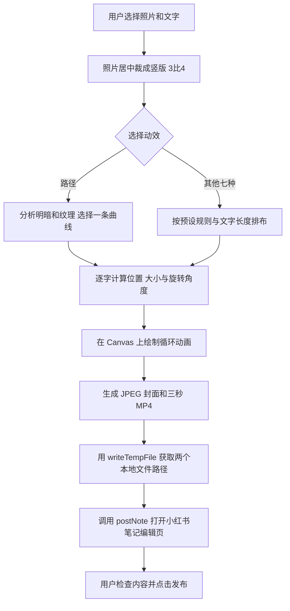

# shamsham 文字动效与live图实现

shamsham 是一个运行在小红书里的照片文字小工具：用户选照片、改文字，再选一种文字动效；程序把画面生成一张封面和一段短视频，交给小红书的笔记编辑页作为 live图使用，最后由用户确认发布。

这份说明面向想了解制作原理、也想自己实现的人。文字路径部分依据 1.0.13 的源代码，发布部分结合此前已经由用户扫码确认可用的版本。1.0.13 的本地检查与提交审核不等于新版已经通过手机发布验证。

## 整体流程



这里有三个不同的工作：文字动画决定每一帧长什么样，视频编码把这些画面做成可播放的文件，小红书接口负责把素材送进原生编辑页。只做好网页上的动画，不代表已经具备 live图发布能力。

## 项目组成

| 文件 | 作用 |
| --- | --- |
| `index.html`、`style.css` | 选照片、编辑文字、选择动态和调整样式 |
| `path.js` | 分析照片、选择曲线、计算文字在曲线上的位置 |
| `motion.js`、本地 Anime.js | 控制移动进度、透明度、缓动和三秒循环 |
| `app.js` | 把照片和文字画到 Canvas，并串起生成和发布流程 |
| `mp4.js` | 将像素帧编码为 H.264 视频并封装成 MP4 |
| `captions.js` | 随机取用 50 句配文，组织发布标题、正文和话题文字 |
| `publish-entry.js` | 提前绑定发布按钮，展示阶段与错误，避免按钮没有反馈 |
| `assets/fonts`、`licenses` | 三款本地中文字体与第三方授权 |

项目使用 HTML、CSS、JavaScript 和 Canvas 2D。文字路径在设备本地计算，没有调用图像生成模型，也没有做语义主体识别。Anime.js 负责时间变化，照片分析和曲线排字由项目代码完成。

## 八种文字动效

**目前只有第一种“路径”会根据照片内容调整曲线。** 另外七种使用预设运动规则，根据文字长度、字号、画布尺寸与固定随机种子排布；它们不读取照片的明暗和纹理来决定运动，也不识别照片里的形状。

| 动效 | 排布与运动方式 | 照片内容是否影响轨迹 |
| --- | --- | --- |
| 路径 | 根据照片评分选择平滑曲线，文字沿曲线移动，朝向随曲线变化 | 是，使用本地像素统计 |
| 逐字 | 文字保持成句，大小高低错落，依次出现，出完停留再循环 | 否 |
| 漂浮 | 按字数确定基础位置，叠加轻微横移、上下移动、旋转和缩放，各字节奏错开 | 否 |
| 波浪 | 文字分行排列，相邻字符的上下运动错开时间，形成波浪 | 否 |
| 环绕 | 沿画面中部的预设椭圆运动，字多时分成多圈，并改变透明度和大小表现远近 | 否 |
| 呼吸 | 保持成句，所有字同步缓慢放大、缩小 | 否 |
| 摇摆 | 保持成句，各字在原有倾斜角度上来回摆动 | 否 |
| 弹跳 | 保持成句，每个字错开时间向上跳，再落回原位并小幅回弹 | 否 |

“预设”指运动规则预先写好，不是把文字动画存成一张固定素材。每次仍会根据当前文字和参数重新计算。例如文字变长时会换行或缩小以适配画布；点击重新排布会换一个种子，改变各字固定的大小、高低和角度。

若保持文字、字体、字号、种子和时间相同，仅更换背景照片，其他七种的文字排布与运动结果不会因此改变。换图后看到不同排布，也可能是自动配文换了句子，而不是算法识别了新照片。环绕围着的是预设椭圆，不是照片主体。

字体与颜色由用户选择，照片分析不会自动替换字体、配色或动效类型。上传代码仍会计算一个照片色彩分类，但当前动效绘制不使用这个分类；不能因此说所有动效都在根据照片调整样式。

八种动效最终共用同一套封面、MP4 生成和小红书发布流程，区别在于每帧如何画文字。

## 文字路径

### 照片分析

选图后先居中裁成 3:4。为了分析画面，程序另外画一张 **96×128** 的小图，读取像素，计算三个量：明暗变化形成的边缘、颜色与照片边缘平均颜色的差异、颜色饱和程度。

这些数值合起来形成一张位置评分图。纹理和边缘越明显的地方，分数通常越高；较平缓的区域，分数通常较低。程序再对邻域求平均，避免曲线只穿过几个孤立的小空隙。

这个方法是在寻找较少干扰文字的区域，不知道照片里哪一块是人、猫、食物或天空，也不保证文字一定绕过主体。无法读取像素时，仍可使用固定种子生成一条曲线。

### 曲线选择

程序生成 **72 条候选曲线**，包含拱形、下凹形和柔和的 S 形，改变高度、起伏与倾斜。每条曲线沿途采样评分，选择综合分数较低的一条，再小范围调整各个点的位置，并平滑四遍。

接着用 Catmull–Rom 插值把这些点连接成平滑曲线，得到 **241 个采样点**。可以把这一步理解成：先定几个路标，再用一条柔和的线把它们连起来。

为了保留手绘感，曲线上加入很轻的固定起伏。随机种子不随动画时间改变，因此同一张照片、同一组参数的轨迹会保持稳定，不会每一帧重新随机、导致文字抖动。

### 沿线排字

文字按字拆开，使用 `measureText` 测出每个字的实际宽度，再依次安排到曲线上。每个字都有小幅、固定的大小变化、高低偏移和倾斜，而句子仍然保持顺序。

位置按“沿曲线走了多远”计算，而不是平均分配曲线参数。代码先累计各段长度，再用二分查找定位字符的目标点，避免弯曲程度不同的地方出现字距忽大忽小。

每个点还会算出曲线的方向，即切线角度。画字时使用这个角度旋转，并沿垂直方向把字稍稍抬离曲线，形成文字贴着手绘线排列的感觉。

概念关系如下，其中字符间距和随机偏移都来自已生成的排版结果：

```text
字符沿线位置 = 全句起点 + 前面字符累计宽度 - 当前动画偏移
字符旋转角度 = 所在位置的曲线方向 + 固定的小幅倾斜
字符显示大小 = 本行适配字号 × 该字符的固定缩放
```

较长文字会分成多行曲线，每行最多约 28 个字符，并按可用长度适配字号；输入总量保留前 80 个字符。更换字体后会重新测量字宽。

### 循环动画

Anime.js 提供每个时刻的移动进度和透明度。程序不断取出当前进度，重新计算字符在同一条曲线上的位置，再绘制这一帧。

路径动画的一轮是三秒：开始展示完整句子，随后淡出、回到进入位置，再沿曲线进入并停留，之后重复。第一帧保留完整文字，是为了让生成的封面可读。

屏幕预览与导出共用同一套绘制函数、种子和时间轴。位置按画面比例计算，导出时重新在高清画布绘制，而不是把小预览截图放大。

## live图素材

### 逐帧生成

发布时创建 **1080×1440** 的画布，先绘制时间为 0 的画面，导出质量参数为 0.95 的 JPEG 封面。

随后按 **12 帧每秒、三秒、共 36 帧** 生成视频画面。第 n 帧调用相同绘制函数，时间为 `n / 12` 秒。每帧包含照片背景和当时位置的文字。两帧之间会让出主线程，以便界面继续更新生成状态。

这不是实时录屏。即使手机生成得慢，也按确定的时间点绘制，视频仍保持三秒时长；生成耗时和视频时长是两回事。

### 视频编码

`mp4.js` 是项目中的本地 JavaScript 编码器。它使用 H.264 Baseline 的 I_PCM 宏块，把像素帧写成视频数据，再封装为 MP4；后续帧对完全没变化的块进行跳过处理，减少静止照片区域的重复数据。

这种实现不依赖 FFmpeg、WebAssembly、联网服务或浏览器自带视频编码器。代价是压缩效率较低，文件可能比较大，高清导出也会增加生成时间和内存占用。它是这个项目的具体实现选择，不是小红书要求必须使用的编码方式。

把文件后缀改为 `.mp4` 不会完成编码。实际视频必须能被正常解码，读到有效尺寸、时长和首帧。

### 封面与视频配对

交给小红书的 live图素材是一组数据：

```text
封面 JPEG 路径 + 对应 MP4 路径
```

这里的目标是小红书笔记中的 live图。项目没有实现苹果相册 Live Photo 所需的照片库写入和配对元数据，也不把 GIF 当作 live图。

用户不需要先将 live图保存到相册，再从相册选回来。程序生成封面和视频后，可以直接交给小红书发布接口。当前小工具左下角的保存按钮走静态图片保存接口，和右侧的 live图发布流程不同。

## 小红书发布

### 官方接口

小红书小工具容器会注入 `window.xhs.miniTool`。本项目使用：

- `writeTempFile`：把封面和视频写入容器临时文件，返回可交给原生接口的 `filePath`。
- `postNote`：携带媒体、标题和正文，打开小红书原生笔记编辑页。

普通浏览器没有这组原生能力。本地站点可以看动画和生成素材，但不能据此声称已成功打开手机的小红书发布页。

2026-11-06 核对的[官方发布文档](https://miniapp-sandbox.xiaohongshu.com/minitool/doc#s3-3)中，live图字段为 `mediaInfo.live_photo_resources`，每项包含封面 `url` 和视频 `video_url`；文档写明 live图能力需要客户端 9.43 及以上。接口规则可能更新，接入时应重新核对。

### 主流程示例

以下示例从已经生成的 JPEG 和 MP4 开始，省略界面、客户端版本检查、素材解码验证与历史兼容处理；不是完整应用。完整历史工程见[版本归档](../snapshots/README.md)。

```js
let publishing = false;

function blobToDataUrl(blob) {
  return new Promise((resolve, reject) => {
    const reader = new FileReader();
    reader.onload = () => resolve(reader.result);
    reader.onerror = () => reject(new Error('视频读取失败'));
    reader.readAsDataURL(blob);
  });
}

async function openLiveEditor(coverDataUrl, mp4Blob, title, content) {
  if (publishing) return;
  const sdk = window.xhs && window.xhs.miniTool;
  if (!sdk || typeof sdk.writeTempFile !== 'function' ||
      typeof sdk.postNote !== 'function') {
    throw new Error('请在小红书小工具内打开');
  }

  publishing = true;
  try {
    const cover = await sdk.writeTempFile({ data: coverDataUrl });
    const video = await sdk.writeTempFile({
      data: await blobToDataUrl(mp4Blob)
    });
    if (!cover.filePath || !video.filePath) {
      throw new Error('素材写入失败');
    }
    return await sdk.postNote({
      title,
      content,
      pageType: 'slides_edit',
      mediaInfo: {
        live_photo_resources: [{
          url: cover.filePath,
          video_url: video.filePath
        }]
      }
    });
  } finally {
    publishing = false;
  }
}
```

`mediaInfo` 传对象，避免自行重复序列化。封面和视频必须等待写入完成，只用接口返回的完整路径，不拼接或猜测路径。项目在调用发布前还会尝试加载视频，检查首帧、尺寸和时长；写入或检查失败就停止。

这个接口打开的是可编辑的发布页，可以理解为“把内容准备好交给用户”。不是后台偷偷发出笔记，也不等于已把草稿永久保存。用户可以继续改内容、取消，或点击发布。接口回调也不代表笔记最终审核通过。

### 项目中的历史兼容

早期文档使用 `live_photo_sources`，排查时官方模拟器使用 `live_photo_resources`，实际项目还遇到 `10001`、`param=mediaInfo` 和 `slides resource too few`。

shamsham 的已成功版本保留了四组组合：两种字段分别配合 `slides_edit` 或 `photo_publish`。只有收到明确的媒体参数拒绝才尝试下一组，仍然是同一组封面和视频；取消、繁忙或其他错误都不连续重发。当前会话会复用已接受的组合。

同时，高清 MP4 统一使用 `writeTempFile` 返回的路径，取消了按视频大小切换到自建持久路径的分支。项目曾经使用的 4MiB 分界只是自身逻辑，不是官方发布上限。

1.0.7 和 1.0.10 有用户扫码成功反馈，但没有记录成功那次完整的原生调用日志，因此不能断言所有手机都必须使用某一个历史组合。新项目应从当前官方契约开始，而不是盲目依次请求四次。完整排错过程见[仓库主文档](../README.md)。

### 标题正文与标签

标题通过 `title` 带入，正文通过 `content` 带入。本项目根据当前配文和动态类型组织内容，正文末尾保留 `#话题` 文字。

正文里有 `#话题`，不等于它已经变成蓝色可点击的原生标签；此前尝试过的独立 `tags` 字段也不在本轮官方小工具公开参数表里。自动挂载小工具不能靠自行猜测字段实现，预览入口和已上线入口的行为还可能不同。这些能力不应当写成已经普遍验证成功。

## 本地开发与小工具打包

先在本地完成页面、动画与素材生成，再按平台当前规范将 HTML、CSS、JavaScript、字体、图片和授权文件打包成 ZIP，`index.html` 放在根目录。脚本与资源随包提供，不依赖外部字体或脚本服务。

本项目的开发预览地址是 `http://127.0.0.1:4187/`。向创作服务平台上传的是小工具离线包，不是把这个开发站点部署成公开网站。

开发过程可以用 AI 编程助手协助实现和排错，但运行时的文字路径由本地算法计算。自动配文目前来自内置的 50 句候选文案，不是上传照片让模型识图生成。

## 验证与代码归档

需要把几类结果分开记录：

| 检查 | 能证明什么 |
| --- | --- |
| 本地动画预览 | 文字排版、曲线、循环和交互可以运行 |
| MP4 解码 | 生成的文件能够播放，尺寸与时长有效 |
| 本地发布测试 | 调用参数、错误处理、防重复等程序逻辑符合预期 |
| 小红书真机编辑页 | 当前手机和客户端接受素材，并以 live图形式呈现 |
| 平台审核状态 | 小工具版本是否获准上线，与某一条用户笔记是否发布是不同流程 |

实际验收还应检查：换图后不复用旧素材、中文字体正确、完整句子可读、返回后可再次生成、连续点击不重复请求，以及原生编辑页中确实能播放 live图。

[版本归档](../snapshots/README.md)保留用户确认可用的完整原始 ZIP 和 SHA256。1.0.7、1.0.10 可用于对照发布流程；它们早于“路径”效果的加入，不能将旧包描述为包含本文的最新路径界面。本文对新路径的解释来自后续代码，尚未将 1.0.13 列入真机成功归档。

本轮只更新说明，不修改已归档的历史成功包，也不据本地测试补写手机成功记录。
